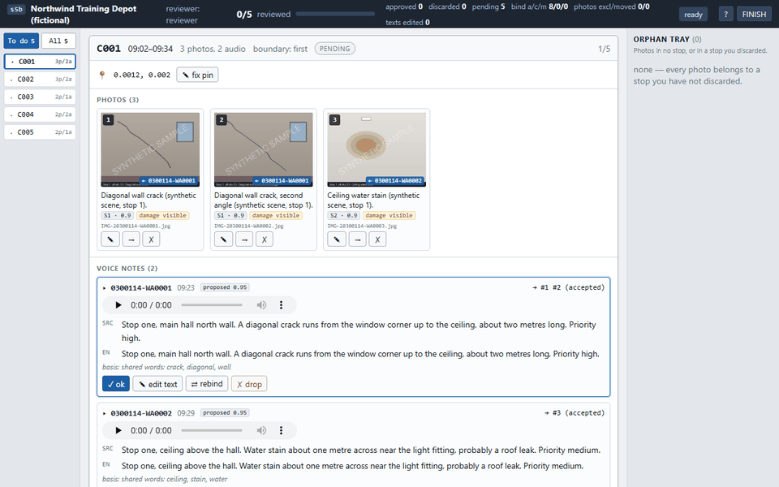
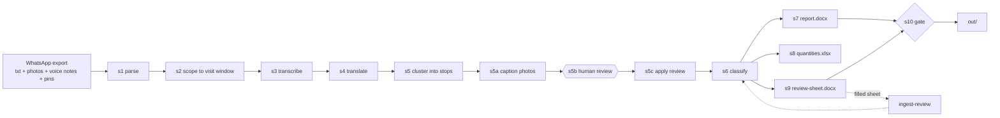

# field-report-pipeline

Turns a WhatsApp field export (chat text, photos, voice notes, location pins) into a Word report and a reviewer sheet, on a CPU, with no API key.



*Synthetic site walk, offline demo: the review app, two pages of `report.docx`, and `review-sheet.docx`. The report pages are an HTML render of the .docx (no Word or LibreOffice here), and the sheet's dropdown cells are not drawn.*

## Quickstart

Python 3.10 or newer. No key is needed for anything in this section.

PowerShell:

```powershell
uv venv --python 3.11
.venv\Scripts\Activate.ps1
uv pip install -e ".[dev]"
python -m field_report demo --offline
```

bash:

```bash
uv venv --python 3.11
source .venv/bin/activate
uv pip install -e ".[dev]"
python -m field_report demo --offline
```

`.\scripts\demo.ps1` is a PowerShell wrapper for the same command. The `Makefile` (`make demo-offline`) wraps it for Linux and macOS; it was not run on the Windows machine used here.

The demo generates the synthetic sample if it is missing, runs all ten stages and writes to `out/demo/`:
`report.docx`, `review-sheet.docx`, `run-manifest.json`. Intermediate files are kept in `out/demo/work/`.
It exits 0 in about one second on the machine used for the run recorded below.

Other profiles and the real speech-to-text path:

```bash
python -m field_report demo --offline --profile damage-assessment   # also writes quantities.xlsx
python -m field_report demo --offline --profile event-log
python -m field_report demo --asr-model tiny                        # faster-whisper, CPU, int8
```

The last command downloads the `tiny` model (about 75 MB) once into the Hugging Face cache, or into `FRP_MODEL_DIR` if set. After that it runs offline. On the synthetic voice notes, `tiny` recovered 0.90 of the scripted words (pooled recall over 8 notes).

Tests and lint:

```bash
python -m pytest -q
python -m ruff check .
```

Review a run by hand instead of auto-accepting it:

```bash
python -m field_report run --config examples/sample/config.json --offline --until s5a
python -m field_report review --config examples/sample/config.json     # 127.0.0.1:8770, autosaves review.json
python -m field_report run --config examples/sample/config.json --offline
```

The last command stops at the review gate and prints instructions until every stop has a verdict.
Add `--auto` to waive the gate; every finding is then marked unreviewed. Artifacts go to `out/runs/<site_slug>/`.

Optional, bring your own key: `--captions anthropic` and `--classify anthropic` read `ANTHROPIC_API_KEY`
(see [Experimental](#status)). Copy `.env.example` to `.env` and fill it in only if you use them.

## What it does



- Parses Android and iOS WhatsApp export formats, including attachments, location pins, edited, deleted and `<Media omitted>` lines, and multi-line messages ([formats](docs/WHATSAPP-FORMATS.md)).
- Groups messages into stops. A lone `.` message closes a stop; a pin inside a stop is a position, not a boundary. A 30-minute gap closes a stop if the dot was forgotten.
- Transcribes voice notes with faster-whisper on CPU, or reads ground-truth sidecar files. Whisper's translate task handles notes that are not in English.
- Binds each photo to a stop and gives it a caption. The default caption backend reads sidecar files; there is no vision model in the zero-key path.
- Classifies each stop with keyword rules and a rating scale taken from a profile file. Three profiles ship: `site-inspection`, `damage-assessment`, `event-log` ([how to write one](docs/PROFILES.md)).
- Offers a local browser review app (127.0.0.1 only). If nobody reviews, every stop is marked "unreviewed" in the report.
- Builds a reviewer sheet with Word dropdown content controls, one per open item. `ingest-review` reads the filled sheet back by control tag.
- Ends in a deterministic gate (s10): every photo embedded once, every number traced to a transcript, every open item on the sheet, no named individuals, neutral file metadata. Exit code 4 on failure ([stages and exit codes](docs/ARCHITECTURE.md)).

## What is synthetic

Everything under `examples/` and `tests/fixtures/` is invented, and so is every image in `docs/media/`.

- Site: "Northwind Training Depot (fictional)". People: "Alex Demo" and "Sam Sample". Date: 14 January 2030.
- 40 chat messages, 5 stops, 4 location pins within 500 m of 0°N 0°E, 12 photos drawn with Pillow (each watermarked "SYNTHETIC SAMPLE"), 8 voice notes made from scripted text.
- Voice notes are text-to-speech. A pre-rendered set is committed in `examples/sample_voice/`, so no TTS engine is needed.
- The report cover says "Generated from synthetic sample data" whenever `sample_manifest.json` is present.

Regenerate the sample (deterministic for a given seed, apart from TTS audio bytes):

```bash
python examples/make_sample.py --out examples/sample --seed 7 --tts none
python examples/make_sample.py --out examples/sample-damage --seed 7 --tts none --profile damage-assessment
```

`--format ios` writes the iOS export grammar. `--tts auto` tries `pyttsx3` and re-renders the voice notes.

## Status

Ran in the original private deployment: the same stage chain on real WhatsApp exports, to produce preliminary damage-assessment reports. No figures from that deployment are published here.

Recorded in this edition, on synthetic data (runner output, Windows 11, Python 3.11):

| Check | Result |
|---|---|
| `python -m pytest -q` | 324 passed, 1 skipped (the skipped test is the real-ASR test, run only with `FRP_RUN_SLOW=1`) |
| `python -m ruff check .` | All checks passed |
| `demo --offline` (all three profiles) | exit 0, s10 gate passed, about 1 to 2 s each |
| `demo --asr-model tiny` | exit 0, about 10–20 s with the model already cached |
| Real ASR vs scripted text | pooled word recall 0.90 over 8 notes (per-note minimum 0.75) |

Experimental:

- `--captions anthropic` and `--classify anthropic`. Opt-in; needs `pip install -e ".[anthropic]"` and `ANTHROPIC_API_KEY`; model from `FRP_ANTHROPIC_MODEL`. Output is forced through a tool-use JSON schema and checked in code (category in the profile or `unclear`, rating in the profile scale, evidence references exist). Invalid output is retried twice with the error fed back. The loop ends on `stop_reason`; `max_tokens` counts as failure. The tests mock the client and never touch the network. It has not been run against the live API in this edition.
- `--redact-faces` (OpenCV Haar cascade blur, `pip install -e ".[faces]"`).
- Keyword classification is a first pass for a human to check, not a finding of fact.

## Origin

First built to turn field-survey WhatsApp exports into preliminary damage-assessment reports for public buildings after a conflict. Built at an engineering consultancy; this edition is cleaned and runs on synthetic data.

## Licence

MIT. See [LICENSE](LICENSE). Third-party packages keep their own licences (faster-whisper, python-docx, openpyxl, jsonschema, Pillow, PyAV, and the optional OpenCV and Anthropic SDK).
