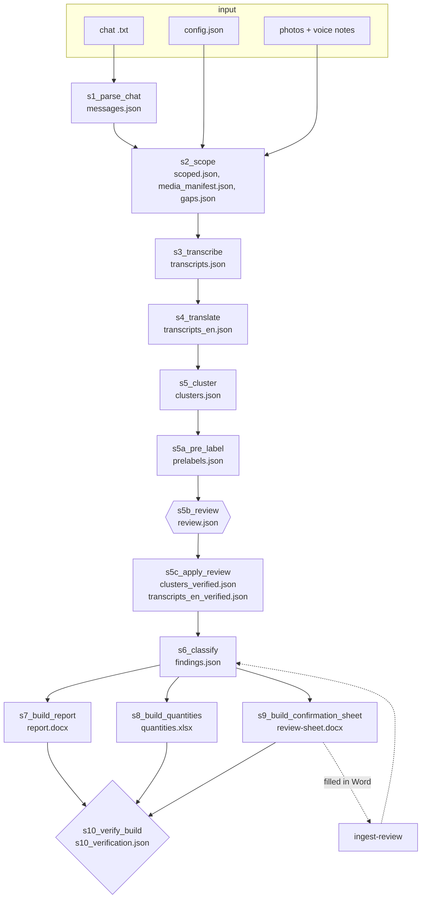

# Architecture

One command chains ten stages. Each stage is a module in `field_report/stages/`, reads JSON written by the stage before it, validates its own output against a schema in `field_report/schemas/`, and writes one artifact. `field_report/run.py` is the driver. It decides what to do from stage exit codes and artifact status fields, never from log text.



## Stages

| Stage | Module | What it does | Backend choices |
|---|---|---|---|
| s1 | `s1_parse_chat` | Chat text to `messages.json`. Detects Android or iOS grammar ([details](WHATSAPP-FORMATS.md)). | none |
| s2 | `s2_scope` | Keeps messages inside `date_from`..`date_to`, inventories media, records gaps (files named in the chat but missing). | none |
| s3 | `s3_transcribe` | Voice notes to text. | `--asr faster-whisper` (default; `--asr-model tiny\|base\|small\|large-v3`, `--device auto\|cpu\|cuda`) or `sidecar` |
| s4 | `s4_translate` | English text for each note. | `--translate whisper` (Whisper translate task when the language is not English) or `none` |
| s5 | `s5_cluster` | Groups messages into stops: dot separators, pins as positions, time-gap safety net. | none |
| s5a | `s5a_pre_label` | Captions photos, proposes which voice note and photo belong together. | `--captions sidecar` (used by `--offline`), `none`, `anthropic` (experimental) |
| s5b | `s5b_review` | Human gate. Browser app on 127.0.0.1:8770, or `--auto` to accept everything as unreviewed. | none |
| s5c | `s5c_apply_review` | Applies verdicts. Idempotent. Auto-accepted stops are not marked human-verified. | none |
| s6 | `s6_classify` | Category, rating and quantities per stop, from the profile. | `--classify keyword` (default) or `anthropic` (experimental) |
| s7 | `s7_build_report` | `report.docx` from `findings.json`. | none |
| s8 | `s8_build_quantities` | `quantities.xlsx`; does nothing unless the profile sets `quantities_sheet`. No price columns. | none |
| s9 | `s9_build_confirmation_sheet` | `review-sheet.docx` with one dropdown content control per open item. | none |
| s10 | `s10_verify_build` | Readiness gate, checks G1 to G9 (listed in the module docstring). | none |

`--offline` is shorthand for `--asr sidecar --captions sidecar --classify keyword`.

## Artifacts

Everything lands in the run directory (`out/demo/work/` for the demo, `out/runs/<site_slug>/` for `run`). `demo` also copies the deliverables up one level.

| File | Written by | Content |
|---|---|---|
| `messages.json` | s1 | every parsed message: timestamp, sender, kind, text, media filename, pin |
| `scoped.json`, `media_manifest.json`, `gaps.json` | s2 | in-window messages, media inventory, missing files |
| `transcripts.json`, `transcripts_en.json` | s3, s4 | text and detected language per voice note |
| `clusters.json` | s5 | stops with their photos, notes and positions |
| `prelabels.json` | s5a | captions and proposed bindings, with confidence |
| `review.json` | s5b | one verdict per stop, autosaved |
| `clusters_verified.json`, `transcripts_en_verified.json` | s5c | the above after the review |
| `findings.json` | s6 | categories, items, ratings, quantities, evidence references |
| `report.docx`, `report_build.json` | s7 | the report and its build record |
| `quantities.xlsx` | s8 | quantities per item (damage-assessment only) |
| `review-sheet.docx`, `confirmation_sheet.json` | s9 | the sheet and the list of items on it |
| `s10_verification.json` | s10 | result of each gate check |
| `run-manifest.json` | run.py | backends used, per-stage status and time, exit code |

## Exit codes

Driver (`run`, `demo`): 0 reached the end, or stopped cleanly at the review gate. 2 bad invocation, bad config or an unavailable backend. 3 a stage reported item-level problems; the run continues and the worst code seen is returned. 4 a stage failed. 5 a stage found its upstream artifact missing.

`s10_verify_build`: 0 pass, 2 bad invocation, 4 blocking problems, 5 a file to check is missing. Two checks (leftover placeholder text, personal file paths) are advisory and do not block.

`s5c_apply_review`: 0 ok, 3 partial, 4 conflicting instructions.

## Review gate and the unreviewed flag

`run` stops after s5a until `review.json` has no pending stop. `--auto` fills it with accept-all verdicts and notes "auto-accepted, unreviewed" on each stop. The report carries that note on the cover and in the summary, and gate check G7 fails if unreviewed stops are not declared as such.

## Reviewer sheet round trip

s9 writes one content control per open item, tagged by item key. Fill the dropdowns in Word, then:

```bash
python -m field_report ingest-review --config <config.json> --from-docx review-sheet.docx [--dry-run]
```

Answers are read by tag, applied to `findings.json`, and stamped in the item note ("confirmed by reviewer (Rev1)"). Rebuild s7 to see them in the report.
